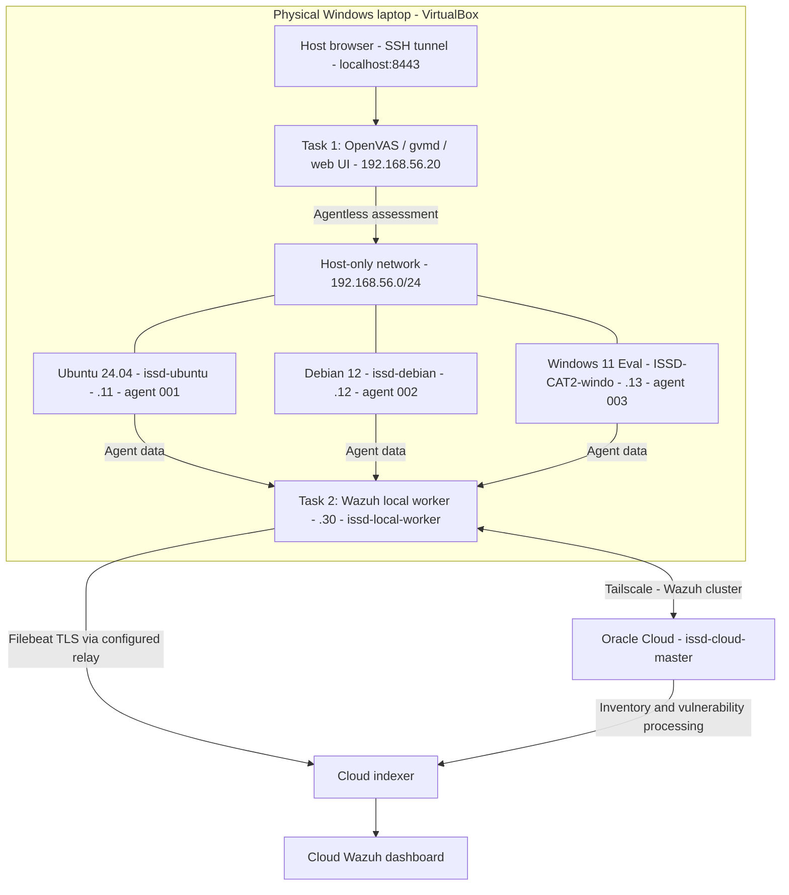

# Evidence-backed network topology

Reviewed 27 October 2026 against private evidence from Members 1, 4, 5 and 6. This diagram describes captured configuration, not current uptime. It supersedes the pre-manager `M4-09_Topology.png` (retain that image as installation history).

## Paths and limits

- NAT adapters support outbound updates; they are not the scanner-to-target path. Host-only keeps vulnerable services off the public LAN. Both tasks reuse the same three endpoints.
- Greenbone `gvmd` consolidates targets, tasks and reports; OpenVAS performs network tests; feeds supply vulnerability tests; the web UI presents results.
- Wazuh agents collect local inventory and send it to the local worker. The master/worker cluster shares agent registration/state; this is distinct from event forwarding and vulnerability indexing. Filebeat carries event data; do not describe it as the vulnerability-inventory synchronization mechanism.
- `M5-11` shows master and worker on 4.14.9. `M4-07` and `M5-14` show three active agents assigned to the worker; `M5-15` shows cloud inventory rows. These support the architecture, but `M5-12` contains `n/a` sync fields: obtain a fresh state-change/timestamp demonstration before claiming complete local/cloud synchronization.
- `M5-13...-2.png` shows Filebeat TLS output to `127.0.0.1:9200`; that alone does not establish the relay's remote destination. Member 5 must show the sanitized relay mapping and cloud receipt.
- Host-only networks on separate laptops are separate. Tailscale is the approved private inter-machine route in the captured design; do not expose agent, cluster or indexer ports to the public internet.
- A 16 GB laptop should demonstrate Tasks 1 and 2 separately; avoid running scanner, worker and all targets together unnecessarily.
